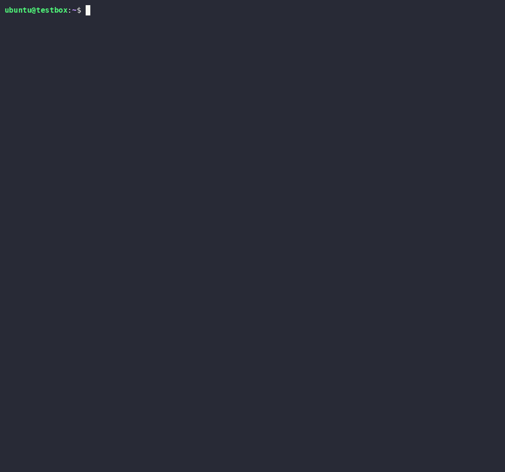

# srcdump

An `objdump`-like tool that prints decompiled code instead of disassembly.

When running in a terminal, srcdump opens an interactive session.
When piped or redirected to a file, srcdump dumps every function as text.
See [Interactive TUI](#interactive-tui).

```
$ srcdump ./program             # interactive TUI (when run in a terminal)
$ srcdump ./program | less      # plain dump (when piped/redirected)
```

A recording of srcdump in action:



Alternatively, you can decompile one or more functions, or list all functions in the binary without decompiling anything.

```
$ srcdump -f main ./program     # just one function (by name or 0xADDR)
$ srcdump -l ./program          # list functions, don't decompile
```

## How it works

srcdump is a thin orchestrator written in Rust.
Binary loading, CFG recovery, and decompilation happens in angr.
srcdump heavily relies on [uv](https://github.com/astral-sh/uv/), parallelism, and caching for speed.

### Virtual environment (uv & angr)

When running for the first time, srcdump creates a virtual environment with angr downloaded and installed.
For distribution without network access, srcdump unpacks the angr environment from  `uv_angr.zip`.
You can remove the virtual environment by running `srcdump --remove-venv`.

### Caching

srcdump caches the CFG and the decompilation results, keyed by the SHA-256 of the binary:

```
${XDG_CACHE_HOME:-~/.cache}/srcdump/<sha256>/db.adb              # CFG (angrdb)
${XDG_CACHE_HOME:-~/.cache}/srcdump/<sha256>/catalog.json        # function catalog
${XDG_CACHE_HOME:-~/.cache}/srcdump/<sha256>/decomp/0x<addr>.json
```

Each decompilation records the angr version that produced it. A cached function
decompiled by a different angr version than the one in use is reused (not
re-decompiled) but annotated with a `// cached: decompiled with angr …` comment.

- `--redecompile` — re-decompile everything, overwriting the cache (keeps the CFG).
- `--rebuild` — rebuild the CFG and clear the decompilation cache.
- `--cache-dir <DIR>` — relocate the cache.

## Usage

```
srcdump [OPTIONS] [FILE]

Options:
  -f, --function <NAME|ADDR>  Only decompile these functions (repeatable)
  -l, --list                  List functions instead of decompiling
      --slowest <N>           Report the N slowest functions by decompile time
  -j, --jobs <N>              Parallel workers (default: CPU count, capped so
                              each worker has ~3 GiB of available RAM;
                              override with $SRCDUMP_WORKER_RAM_MB, and 1 GiB
                              is used automatically under CI)
      --load-libs             Enable angr's auto_load_libs (off by default)
      --include-plt           Include PLT stubs in the output
      --rebuild               Rebuild the CFG and clear the decompilation cache
      --redecompile           Re-decompile, ignoring the decompilation cache
      --cache-dir <DIR>       Override the cache location
      --progress <WHEN>       Progress display: auto (default), always, never
      --tui <WHEN>            Interactive browser: auto (default), always, never
      --color <WHEN>          Syntax-highlight the dump: auto, always, never
  -y, --yes                   Skip confirmation prompts (e.g. for --remove-env)
  -h, --help                  Print help (-h for a summary)
  -V, --version               Print version

  Python environment:
      --venv <DIR>            Use an existing virtualenv with angr (skips uv)
      --env-dir <DIR>         Location of the managed env
      --env-archive <FILE>    Provision the env from a prebuilt zip
      --refresh-env           Recreate / upgrade the managed angr env
      --remove-env            Remove the managed env and exit
      --python-version <X.Y>  Python version for the managed env (default 3.14)
      --python <PATH>         Low-level: exact interpreter (skips management)
```

### Interactive TUI

| Key | Action |
|-----|--------|
| `j` / `k` | move the highlighted line down / up (crosses function boundaries) |
| `.` / `,` | jump to the next / previous function |
| `g` | go to a function by name or address (hex) |
| `/` | full-text search (case-insensitive) |
| `F3` / `F4` | next / previous search match |
| `f` | toggle the function panel (sidebar) |
| `t` | toggle per-function decompilation times (off by default) |
| `h` | toggle the help panel |
| `q`, `Esc` | quit (terminates any outstanding workers) |

## Goals & Roadmap

srcdump aims at quickly dumping the decompilation (pseudocode) of a small-to-medium sized binary with some basic level of interaction (potentially friendlier to AI agents).
We strongly recommend using angr, its CLI, its GUI, or any other binary analysis tools for advanced, complete, and long-running binary reverse engineering tasks.

Immediate next steps:
- Do not decompile long/large functions until users force the decompilation.
- Improve angr so that decompilation of functions is faster.
- Binary language detection.
- Decompile to Rust pseudocode for Rust binaries.
- Line wrapping in angr decompiler.

